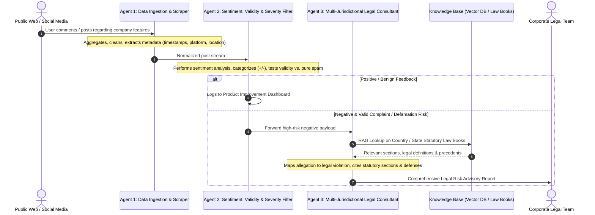

# System Architecture & Technical Design 🏛️

This document stores technical designs, architecture diagrams, data models, agent loops, and integration schemas for the college project.

---

## 🎯 Executive Summary & Project Goal
**System Title:** Multi-Agent Legal Consultation & Risk Intelligence System  
**Core Mission:** Automate the continuous monitoring, sentiment/validity classification, and multi-jurisdictional legal risk assessment of public user comments/posts targeting a company, generating actionable legal advisory dossiers for corporate counsel.

---

## 🤖 The 3-Agent Core Workflow

---

## 🧩 Architectural Responsibilities

### Agent 1: Data Ingestion & Monitoring Agent
- **Role:** Data Harvester & Normalizer.
- **Responsibilities:**
  - Hybrid ingestion: Live streaming via Reddit API (PRAW) + offline batch evaluation via structured CSV/JSON file uploader.
  - Ingest public comments, product reviews, and forum posts referencing company products/features.
  - Extract critical context: Timestamp, User ID/Handle, Platform, Geolocation/Region tag, and Raw Content.
  - Sanitize text (remove HTML, script injections, formatting noise) and deliver clean JSON payloads to Agent 2.

### Agent 2: Sentiment, Validity & Triage Agent
- **Role:** Content Classifier & Risk Assessor.
- **Responsibilities:**
  - **Sentiment Separation:** Categorize feed into Positive, Neutral, and Negative sentiments.
  - **Validity & Authenticity Rubric:** Distinguish between:
    - *Spam / Bot Noise* (Ignored/Archived)
    - *Subjective Discontent / Hyperbole* (Non-actionable, archived for product feedback)
    - *Factual Grievance* (Actionable: specific claim of financial, physical, or service deficiency)
    - *Defamation / Corporate Slander* (Actionable: targeted false factual claims harming reputation)
  - **Triage & Routing:** Route only *Actionable* grievances to Agent 3 with an assigned urgency flag.

### Agent 3: Statutory Legal Consultation Agent
- **Role:** Autonomous Legal Analyst.
- **Scope (Indian Law Frozen Scope):**
  1. *The Consumer Protection Act, 2019* (Deficiency in service, misleading advertisements, unfair trade practices).
  2. *The Information Technology Act, 2000* (Intermediary liability, digital fraud, data privacy violations).
  3. *Bharatiya Nyaya Sanhita (BNS) / IPC* (Criminal defamation, corporate fraud).
- **Responsibilities:**
  - **Statutory Retrieval-Augmented Generation (RAG):** Query a local persistent ChromaDB vector store containing section-chunked Indian statutes.
  - **Section-Level Citation:** Map the grievance to the exact Act, Chapter, Section, Subsection, and statutory penalties/remedies.
  - **Risk Severity Grading:** Assign exposure rating (`Low`, `Medium`, `High`, `Critical`).
  - **Executive Dossier Generation:** Trigger the PDF generation module (ReportLab) to compile an official executive legal risk advisory dossier for the Corporate Legal Counsel.

---

## 🛠️ Technology Stack

| Layer | Selected Technology | Rationale / Viva Defense |
| :--- | :--- | :--- |
| **Agent Orchestration** | **LangGraph (Python)** | Industry-standard multi-agent state graph with cyclic loops, conditional routing, and state reducers. |
| **LLM Inference Engine** | **Google Gemini (1.5 / 2.0)** | Large context window, strong statutory reasoning, native structured JSON output. |
| **Vector Database** | **ChromaDB (Local / Embedded)** | Zero-cost, runs on local disk (`./chroma_data`), supports metadata filtering, seamlessly integrates with LangChain/LangGraph. |
| **Ingestion Interfaces** | **Reddit API (PRAW) + CSV/JSON Batch Engine** | Guarantees testability during offline viva exams without internet flakiness, while demonstrating real API ingestion. |
| **Document Export Engine** | **ReportLab (Python)** | Programmatic generation of enterprise-grade, styled PDF legal dossiers with embedded disclaimer. |

---
*Maintained as the technical blueprint of the project.*
