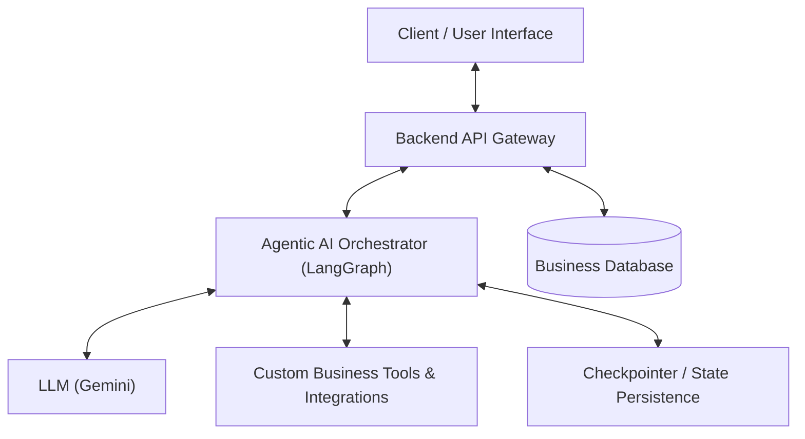

# System Architecture & Technical Design 🏛️

This document stores technical designs, architecture diagrams, data models, agent loops, and integration schemas for the college project.

---

## 🏗️ System Overview
*(Will be detailed as we finalize the design)*

---

## 🛠️ Technology Stack (Proposed)
- **AI / Agent Framework:** LangGraph, LangChain, Google Gemini API
- **Backend:** Node.js, Express
- **Validation:** Zod
- **Database / State:** (To be decided based on requirements)
- **Frontend:** (To be decided based on requirements)

---
*Maintained as the technical blueprint of the project.*
