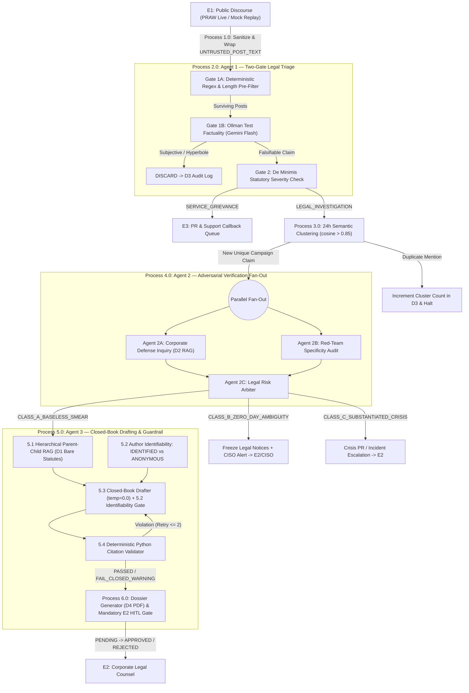

# LegalAdvisor AI: System Architecture & Multi-Agent Blueprint

**Version:** `2.0` (Aligned with `TDD v1.0`, `ADR-001`–`ADR-008`, `DFD Spec`, and `D3 ER Schema`)
**Architectural Style:** Stateful Cyclical Multi-Agent Orchestration (`LangGraph`) + Hybrid Dual-RAG + Deterministic Guardrails
**Primary References:** [TECHNICAL_DESIGN_DOCUMENT.md](file:///d:/agentic_ai_project_1/college_project/TECHNICAL_DESIGN_DOCUMENT.md) | [DATA_FLOW_DIAGRAMS.md](file:///d:/agentic_ai_project_1/college_project/DATA_FLOW_DIAGRAMS.md) | [ER_DIAGRAM.md](file:///d:/agentic_ai_project_1/college_project/ER_DIAGRAM.md)

---

## 1. Architectural Shift: Why Single-Prompt Legal Bots Fail
A single-pass LLM chain analyzing social media criticism fails in enterprise environments for three structural reasons:
1. **Free-Speech vs. Defamation Conflation:** Monolithic prompts escalate harsh opinions and delayed-delivery complaints into legal alerts, driving token waste and catastrophic PR embarrassment.
2. **Streisand Effect Risk:** Without checking whether an alarming claim might actually describe an authentic security flaw or whistleblower report, automated legal notices trigger severe regulatory and reputational backlash.
3. **Citation Hallucination:** Unconstrained LLMs routinely invent statutory subsections or cite repealed Indian laws (`IPC 499/500`, struck-down `IT Act 66A`).

LegalAdvisor AI solves these via a **4-Pillar Multi-Agent State Machine**:
1. **Two-Gate Legal Triage (`Agent 1` — `ADR-001`)**
2. **24h Semantic Campaign Clustering (`Process 3.0` — `ADR-006`)**
3. **Dual-Hypothesis Adversarial Verification (`Agent 2A/2B/2C` — `ADR-002`)**
4. **Closed-Book Statutory RAG + Deterministic Citation Validator + Identifiability Gate (`Agent 3` — `ADR-003`/`ADR-004`/`ADR-005`)**

---

## 2. End-to-End Pipeline Architecture (LangGraph Orchestration)

---

## 3. Agent & Module Responsibilities

### Process `1.0` & `3.0`: Ingestion, Hygiene & Deduplication Clustering (`ADR-006`/`ADR-008`)
- **Dual-Mode Ingestion:** Live subreddit polling via `PRAW` (`PRAW_LIVE`) + deterministic replay JSON stream (`MOCK_REPLAY`) for evaluation and live demos.
- **Prompt-Injection Defense:** Strips HTML/scripts and wraps untrusted user discourse inside explicit boundary delimiters (`<UNTRUSTED_POST_TEXT>`) prior to LLM consumption.
- **Identifiability Tagging:** Records `IDENTIFIED` vs `ANONYMOUS` on `RAW_POSTS` (`D3`).
- **24h Claim Deduplication:** Computes semantic embeddings on escalated claims (`cosine_similarity > 0.85`). Duplicate smear campaign posts increment `CAMPAIGN_CLUSTERS.mention_count` so Agent 2 and Agent 3 execute **once per unique claim cluster**.

### Process `2.0` (`Agent 1`): Two-Gate Legal Triage
- **Stage 1A (Deterministic):** Zero-token local regex + `< 20` char length pruning + brand entity matching.
- **Stage 1B (*Ollman Test* via Gemini Flash):** Separates non-justiciable subjective rage/hyperbole (`DISCARD`) from falsifiable factual claims.
- **Gate 2 (*De Minimis* Filter):** Routes ordinary service/delivery complaints (`SERVICE_GRIEVANCE`) to `SERVICE_GRIEVANCE_TICKETS` (`E3` PR & Support Team) and reserves `LEGAL_INVESTIGATION` solely for `STATUTORY_CRIME` / `MALICIOUS_FRAUD`.

### Process `4.0` (`Agent 2A`, `Agent 2B`, `Agent 2C`): Adversarial Verification
- **`Agent 2A` (Defense Inquirer):** Queries `D2` (Corporate Ground-Truth ChromaDB: SOC2 controls, architecture specs, privacy policies) to test if the allegation is technically impossible.
- **`Agent 2B` (Red-Team Devil's Advocate):** Audits technical epistemic specificity (`redteam_specificity_score` in `[0.0, 1.0]`, zero-day indicators such as specific API routes, port numbers, CVE patterns, internal tokens).
- **`Agent 2C` (Legal Risk Arbiter):** Resolves the **Tri-State Matrix**:
  - `CLASS_A_BASELESS_SMEAR`: Contradicts `D2`, low technical specificity, zero proof $\rightarrow$ Advances to `Agent 3`.
  - `CLASS_B_ZERO_DAY_AMBIGUITY`: Unconfirmed by `D2` yet high technical specificity $\rightarrow$ **Freezes all legal notices**, generates a `ciso_alert_required = 1` brief for `E2`/Security Team.
  - `CLASS_C_SUBSTANTIATED_CRISIS`: Verified leak/evidence attached $\rightarrow$ Escalates to Senior Crisis & Incident Counsel.

### Process `5.0` (`Agent 3`): Statutory RAG, Identifiability Gate & Citation Validator
- **Parent-Child Bare-Statutes RAG (`D1`, `ADR-003`):** Queries curated contextual child triggers across ~25–40 Indian Bare Statute & IT Rule sections (*BNS 2023 Sec 356*, *IT Act 2000 Sec 43A/66C/66D/79*, *IT Rules 2021 Rule 3(1)(b)(v) & 3(2)*, *CPA 2019*) and resolves complete unbroken parent statute texts. Multi-decade court case PDFs are explicitly excluded in v1.
- **Identifiability Routing (`ADR-005`):**
  - Always compiles `INTERMEDIARY_TAKEDOWN` (`IT Rules 2021 Rule 3(1)(b)(v) & 3(2)`) + `EXECUTIVE_DOSSIER`.
  - `IDENTIFIED` author $\rightarrow$ Also drafts direct `BNS 356` `CEASE_AND_DESIST`.
  - `ANONYMOUS` author $\rightarrow$ Suppresses direct C&D and drafts an *Ashok Kumar* (`John Doe`) `ASHOK_KUMAR_PRESERVATION` log-preservation order.
- **Closed-Book Drafting & Regex Guardrail (`ADR-004`):** Synthesizes output at `temperature = 0.0`, then runs a deterministic Python validator checking every citation against the current Session RAG Allowlist and rejecting repealed/unconstitutional statutes (`IPC 499/500`, `IT Act 66A`). Up to `max_retries = 2` corrective retries; fails closed on persistent violation.

### Process `6.0`: Artifact Generation (`D4`) & Mandatory HITL Counsel Sign-Off (`ADR-002`/`ADR-007`)
- Exports tamper-evident (`artifact_sha256`) PDF (`ReportLab`/`WeasyPrint`) and Markdown dossiers with embedded non-attorney disclaimers to `D4`, indexed in `D3` (`LEGAL_ARTIFACTS` + `HITL_DECISIONS`). Zero external legal dispatch is permitted without `E2` `APPROVED` status.

---

## 4. Persistence & Technology Stack (`ADR-007`)

| Layer / Store | Selected Technology | Architectural Role |
| :--- | :--- | :--- |
| **Orchestration** | **LangGraph (Python)** + `SqliteSaver` | Cyclical state transitions, Agent 2A/2B parallel fan-out, checkpoint resumability |
| **LLM Inference** | **Gemini Flash** (Triage) + **Gemini Pro** (`temp=0.0` Legal) | Cost-tiered inference wrapped in `tenacity` exponential backoff |
| **Backend API** | **FastAPI (Python)** | Ingestion endpoints, HITL decision API, evaluation metrics endpoints |
| **Vector Store `D1`** | **ChromaDB (Local)** | Hierarchical Parent-Child Indian Bare Statutes & IT Rules (`statutes_corpus.json`) |
| **Vector Store `D2`** | **ChromaDB (Local)** | Corporate ground-truth policies, SOC2, and architecture docs |
| **Relational DB `D3`** | **SQLite (3NF Schema)** | `RAW_POSTS`, `CAMPAIGN_CLUSTERS`, `TRIAGE_AUDITS`, `ADVERSARIAL_ASSESSMENTS`, `LEGAL_ARTIFACTS`, `HITL_DECISIONS`, `EVALUATION_RUNS` |
| **Artifact Store `D4`** | **Local Filesystem + ReportLab/WeasyPrint** | Immutable PDF/Markdown dossiers & draft notices (`artifact_sha256`) |
| **HITL Counsel UI** | **React / Next.js (`client/`)** | Interactive counsel queue, evidence diffs, approve/reject/escalate workflows |
| **Eval Harness** | **50-Case `eval_dataset.json`** | CI benchmark enforcing `0%` false escalation, `>=90%` zero-day recall, `100%` citation guardrail pass rate |
