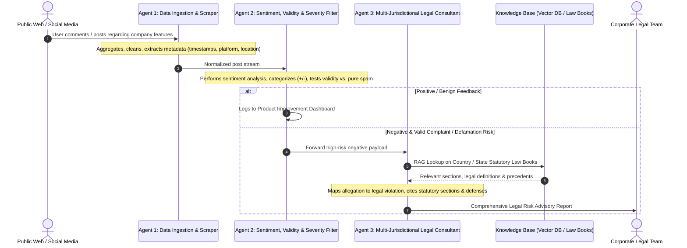

# System Architecture & Technical Design 🏛️

This document stores technical designs, architecture diagrams, data models, agent loops, and integration schemas for the college project.

---

## 🎯 Executive Summary & Project Goal
**System Title:** Multi-Agent Legal Consultation & Risk Intelligence System  
**Core Mission:** Automate the continuous monitoring, sentiment/validity classification, and multi-jurisdictional legal risk assessment of public user comments/posts targeting a company, generating actionable legal advisory dossiers for corporate counsel.

---

## 🤖 The 3-Agent Core Workflow

---

## 🧩 Architectural Responsibilities

### Agent 1: Data Ingestion & Monitoring Agent
- **Role:** Data Harvester & Normalizer.
- **Responsibilities:**
  - Ingest public comments, product reviews, and social media posts referencing the company's products/features.
  - Extract critical context: Timestamp, User Geography/Jurisdiction, Platform, and Topic/Feature discussed.
  - Deliver clean, structured JSON payloads to Agent 2.

### Agent 2: Sentiment, Validity & Triage Agent
- **Role:** Content Classifier & Risk Assessor.
- **Responsibilities:**
  - **Sentiment Separation:** Categorize feed into Positive, Neutral, and Negative sentiments.
  - **Validity & Authenticity Check:** Distinguish between genuine user grievances, factual claims of malfunction/fraud, competitive sabotage, and irrelevant noise/spam.
  - **Triage & Routing:** Archive benign positive feedback; prioritize negative feedback carrying reputational or legal exposure for Agent 3.

### Agent 3: Multi-Jurisdictional Legal Consultation Agent
- **Role:** Autonomous Legal Analyst.
- **Responsibilities:**
  - **Jurisdiction Identification:** Target the appropriate country and state law books (e.g., India IPC/BNS/IT Act, US Defamation/Consumer Protection, EU GDPR/DSA).
  - **Statutory Cross-Referencing:** Identify whether the post alleges a civil/criminal wrongdoing (e.g., consumer fraud, product liability, defamation, breach of privacy, false advertising).
  - **Section-Level Citation:** Pinpoint the exact statutory chapters, sections, penalties, and company rights or liabilities.
  - **Actionable Report Generation:** Produce an executive legal advisory dossier outlining the incident, legal exposure rating, relevant provisions, and recommended next steps (e.g., cease-and-desist, customer remediation, public clarification).

---
*Maintained as the technical blueprint of the project.*
