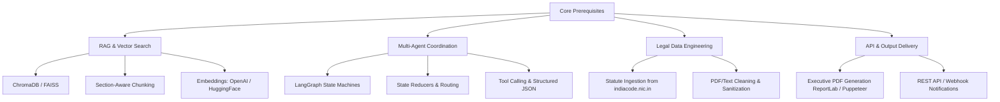

# Project Feasibility, Technical Challenges & Risk Matrix ⚠️🛡️

This document details the critical evaluation, technical bottlenecks, architectural risks, and prerequisites for **LegalAdvisor AI**. It serves as an open reference for all team members, academic advisors, and contributors to understand potential failure points and mitigation strategies.

---

## 🎯 Executive Summary of Project Feasibility

| Assessment Category | Rating | Remarks |
| :--- | :---: | :--- |
| **Idea Viability & Novelty** | ⭐⭐⭐⭐☆ | Solves a real-world enterprise legal blind spot with modern agentic orchestration. |
| **Technical Ambition** | ⭐⭐⭐⭐⭐ | High complexity; combines multi-agent workflows, social listening, RAG, and statutory law. |
| **Current Scope Manageability** | ⭐⭐☆☆☆ | Scope is currently too broad (multi-jurisdiction, undefined scraping). Needs scoping down. |
| **Documentation & Blueprint** | ⭐⭐⭐⭐⭐ | Comprehensive architecture diagrams, problem statements, and logs in place. |
| **College Viva & Panel Appeal** | ⭐⭐⭐⭐☆ | Exceptional if citation accuracy and validation are reliably demonstrated. |

---

## 🛑 Critical Technical Challenges & Bottlenecks

### 1. Agent 3: Statutory Hallucination & Section-Level Accuracy
* **The Problem:** Agent 3 must map unformatted, ambiguous user grievances (e.g., *"their service locked my wallet and stole my money"*) to real legal codes (e.g., Consumer Protection Act 2019, IT Act 2000 Section 43/66).
* **The Risk:** Large Language Models notoriously hallucinate non-existent sections, repealed statutes, or incorrect penalties. In legal consulting, hallucination destroys credibility. A college evaluation panel or legal advisor will immediately fail a project citing phantom clauses.
* **Mitigation Strategy:**
  - Implement strict Retrieval-Augmented Generation (RAG) with citation grounding.
  - LLM prompt constraint: Never cite a statute without direct retrieval matches from the vector database.
  - Two-stage verification: Have a secondary validator prompt check if the cited section actually exists in the retrieved context.

---

### 2. Ambiguity in "Validity" Classification (Agent 2)
* **The Problem:** The concept of "valid complaint" vs. "invalid complaint" is non-trivial:
  - *Opinion/Hyperbole:* "This app is the worst thing ever made." (Negative, but not legally actionable).
  - *Factual Grievance:* "I ordered item #4928 and paid ₹5,000, but received an empty box and support refuses to refund." (Legally actionable consumer dispute).
  - *Defamation / Corporate Sabotage:* False allegations of money laundering or fraud posted by competitors.
* **The Risk:** If Agent 2 cannot distinguish subjective annoyance from factual claims or slander, Agent 3 will either be flooded with junk or miss critical legal liabilities.
* **Mitigation Strategy:**
  - Establish a formal rubric for validity:
    1. **Factual Claim Presence:** Does the post make a verifiable factual allegation?
    2. **Damage/Loss Allegation:** Is there monetary, physical, or reputational damage claimed?
    3. **Tone/Spam Filter:** Does it meet toxicity and bot thresholds?

---

### 3. Data Ingestion & Scraper Bottlenecks (Agent 1)
* **The Problem:** Social media APIs and public review platforms have strict access rules:
  - **X (Twitter) API:** Free tier is strictly limited; full search API costs \$100+/month.
  - **Reddit API:** Stringent rate-limiting and authentication rules.
  - **Google Reviews / App Stores:** No streaming webhook APIs; raw scraping often breaches Terms of Service.
* **The Risk:** Developing custom scrapers that break when platform DOM structures change, leading to pipeline downtime.
* **Mitigation Strategy:**
  - For MVP / College Prototype: Use controlled RSS feeds, Reddit official developer API, or pre-collected synthetic datasets and mock ingestion streams alongside a targeted API wrapper.

---

### 4. Law Knowledge Base Engineering (The Data Pipeline)
* **The Problem:** Statutes cannot simply be dumped into a database. Law books are dense, formatted in hierarchical structures (Part -> Chapter -> Section -> Subsection -> Proviso -> Explanation).
* **The Risk:** Arbitrary token chunking (e.g., standard 500-token chunks) cuts sections in half, severing exceptions from rules and breaking RAG accuracy.
* **Mitigation Strategy:**
  - Custom structural chunking: Chunk legal text strictly by **Section** boundaries.
  - Metadata enrichment: Tag each vector chunk with `jurisdiction`, `statute_name`, `section_number`, and `offense_type`.

---

### 5. Multi-Jurisdictional Scope Creep
* **The Problem:** Attempting to simultaneously support India (BNS/IPC, IT Act, CPA), US (Federal & State torts, FTC regulations), and the EU (GDPR, DSA) is an enterprise-scale effort.
* **The Risk:** Spreading efforts too thin across hundreds of statutory frameworks, resulting in shallow, inaccurate coverage across all of them.
* **Mitigation Strategy:**
  - **Scope Limitation:** Confine the initial production MVP strictly to **Indian Law**:
    1. Consumer Protection Act, 2019
    2. Information Technology Act, 2000 (and amendments)
    3. Relevant criminal/civil provisions (Defamation, Fraud under BNS/IPC)
  - Keep the architecture multi-jurisdiction-ready by maintaining jurisdiction metadata tags.

---

### 6. Evaluation & Benchmarking Strategy
* **The Problem:** How does the team mathematically prove that LegalAdvisor AI works during college viva examinations?
* **The Risk:** Answering *"it works because we tested a few prompts"* will cause panel deduction.
* **Mitigation Strategy:**
  - Create a benchmark test suite of 50–100 curated posts (25 positive, 25 general negative opinions, 25 genuine legal grievances, 25 defamatory attacks).
  - Measure accuracy metrics: Precision, Recall, and F1-score for Agent 2 triage, and Citation Accuracy for Agent 3.

---

## 🛠️ Required Technical Skills & Prerequisites

Before deep implementation begins, collaborators need foundational understanding of:

---

## ❓ Open Architectural Cross-Questions for Team Discussion

1. **Platform Ingestion:** Which exact 2 sources will Agent 1 ingest from first (e.g., Reddit API + Mock Twitter Stream)?
2. **Statutory Scope:** Do we formally freeze the initial knowledge base to Indian Consumer Protection & IT Acts?
3. **Primary Deliverable Format:** Is our MVP output a generated PDF advisory dossier delivered via webhook/email, or a dedicated React dashboard?

---
*Created: October 31, 2026 | Collaborator Technical Review Reference*

