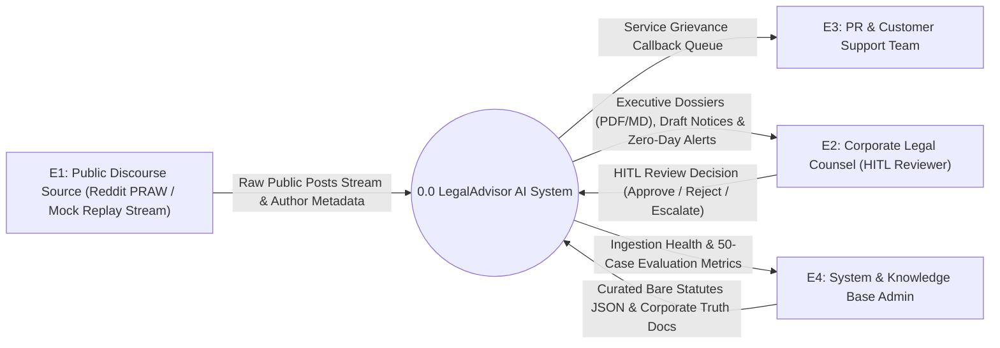
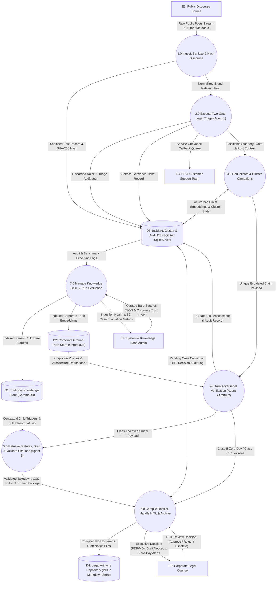
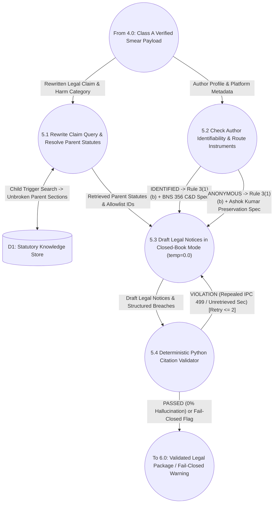

# LegalAdvisor AI: Data Flow Diagrams (DFD) Specification
**Standard:** Yourdon–DeMarco / Gane–Sarson Balanced DFD Specification  
**Aligned With:** [TECHNICAL_DESIGN_DOCUMENT.md](file:///d:/agentic_ai_project_1/college_project/TECHNICAL_DESIGN_DOCUMENT.md) (`Approved v1.0`, `ADR-001` to `ADR-008`)  
**Status:** Ready for Academic Review & Draw.io / Diagram Export  

---

## 1. DFD Structural Rules & Level 0 $\leftrightarrow$ Level 1 Balancing Matrix

To satisfy strict software engineering evaluation criteria:
- **Level 0 (Context Diagram)** contains **zero Data Stores** and **one central System Process (`0.0`)**.
- **Strict Balancing:** Every External Entity (`E1`–`E4`) and every boundary Data Flow entering or leaving `0.0` in Level 0 appears identically in Level 1.
- **No Illegal Flows:** All flows pass through numbered Verb-Noun processes; there are zero Entity-to-Entity or Store-to-Store flows.
- **LLM Compute Boundary Note:** Cloud LLM inference (Gemini Flash / Pro) is modeled as internal computational engine inside Processes `2.0`, `4.0`, and `5.0`, not an external business entity. *(If a security examiner requires modeling third-party cloud API egress, `E5: Cloud LLM Inference API` can be externalized off Processes `2.0`/`4.0`/`5.0` with sanitized `<UNTRUSTED_POST_TEXT>` payloads.)*

### Boundary Balancing Table

| External Entity | Direction | Exact Data Flow Label | Level 0 Target | Level 1 Process |
| :--- | :---: | :--- | :---: | :---: |
| `E1`: Public Discourse Source | $\rightarrow$ System | `Raw Public Posts Stream & Author Metadata` | `0.0` | `1.0` |
| `E2`: Corporate Legal Counsel | $\leftarrow$ System | `Executive Dossiers (PDF/MD), Draft Notices & Zero-Day Alerts` | `0.0` | `6.0` |
| `E2`: Corporate Legal Counsel | $\rightarrow$ System | `HITL Review Decision (Approve / Reject / Escalate)` | `0.0` | `6.0` |
| `E3`: PR & Customer Support Team | $\leftarrow$ System | `Service Grievance Callback Queue` | `0.0` | `2.0` |
| `E4`: Knowledge & System Admin | $\rightarrow$ System | `Curated Bare Statutes JSON & Corporate Truth Docs` | `0.0` | `7.0` |
| `E4`: Knowledge & System Admin | $\leftarrow$ System | `Ingestion Health & 50-Case Evaluation Metrics` | `0.0` | `7.0` |

---

## 2. Level 0 DFD — Context Diagram

Shows the complete system boundary as a single process interacting with its 4 external actors.

---

## 3. Level 1 DFD — Core Multi-Agent & Persistence Architecture

Decomposes `0.0 LegalAdvisor AI` into **7 core processes (`1.0`–`7.0`)** and **4 persistent data stores (`D1`–`D4`)**.

---

## 4. Data Stores & Processes Specification

### 4.1 Data Stores (`D1`–`D4`)

| Store ID | Name | Physical Tech | Stored Data & Purpose |
| :--- | :--- | :--- | :--- |
| **`D1`** | **Statutory Knowledge Store** | ChromaDB (Collection 1) | Curated Indian Bare Statutes (`BNS 2023`, `IT Act 2000`, `IT Rules 2021`, `CPA 2019`) stored as Contextual-Trigger Child Chunks mapped to unbroken Parent Sections. |
| **`D2`** | **Corporate Ground-Truth Store** | ChromaDB (Collection 2) | Internal corporate security whitepapers, SOC2/ISO compliance records, and official product disclosures queried by Agent 2A. |
| **`D3`** | **Operational Incident, Cluster & Audit DB** | SQLite (`SqliteSaver`) / PostgreSQL | Durable LangGraph checkpoints, raw posts + SHA-256 hashes, 24h `CampaignCluster` records, PR callback tickets, and Human Counsel HITL audit trail. |
| **`D4`** | **Legal Artifacts Repository** | Filesystem / Object Store | Compiled Executive Counsel Dossiers (PDF/Markdown), Rule 3(1)(b) Takedown requests, and direct C&D / *Ashok Kumar* Log Preservation notices. |

### 4.2 Process Dictionary (`1.0`–`7.0`)

| Process | Title | Core Transformation Logic |
| :--- | :--- | :--- |
| **`1.0`** | **Ingest, Sanitize & Hash Discourse** | Polls Reddit `PRAW` or loads mock replay streams; strips HTML/scripts; wraps payloads in `<UNTRUSTED_POST_TEXT>`; generates tamper-evident SHA-256 snapshot hash. |
| **`2.0`** | **Execute Two-Gate Legal Triage** | Stage 1A deterministic regex brand-match pruning; Stage 1B Gemini Flash *Ollman Test* factuality filter; Gate 2 *De Minimis* severity gate routing ordinary service disputes to `E3` and severe claims to `3.0`. |
| **`3.0`** | **Deduplicate & Cluster Campaigns** | Compares `falsifiable_claim` embeddings against active 24-hour clusters in `D3` (`cosine_similarity > 0.85`). Merges coordinated bot smears into existing `CampaignCluster` records; forwards only novel claims to `4.0`. |
| **`4.0`** | **Run Adversarial Verification** | Parallel LangGraph fan-out: Agent 2A queries `D2` to refute claim; Agent 2B scores technical specificity for hidden zero-day leaks; Agent 2C outputs `CLASS_A_BASELESS_SMEAR`, `CLASS_B_ZERO_DAY_AMBIGUITY`, or `CLASS_C_SUBSTANTIATED_CRISIS`. |
| **`5.0`** | **Retrieve Statutes, Draft & Validate Citations** | Queries `D1` via Parent-Child retrieval; branches on Author Identifiability (`IDENTIFIED` vs `ANONYMOUS`); enforces Deterministic Python Citation Guardrail (`max_retries=2`). |
| **`6.0`** | **Compile Dossier, Handle HITL & Archive** | Renders PDF/Markdown packages into `D4`; presents dossier/alerts to `E2`; records final `APPROVED` / `REJECTED` counsel actions into `D3`. |
| **`7.0`** | **Manage Knowledge Base & Run Evaluation** | Handles ingestion of curated Bare Statutes into `D1`, corporate records into `D2`, and runs the 50-case `eval_dataset.json` regression suite for `E4`. |

---

## 5. Level 2 DFD — Decomposition of Process `5.0` (Statutory RAG, Guardrail & Identifiability)

Visualizes the internal data flow and cyclical self-correction loop inside Agent 3 (`ADR-003`, `ADR-004`, `ADR-005`).

---

## 6. Document Alignment Warning (Pre-Submission Action Item)
> [!WARNING]
> **SRS & Legacy Architecture Sync Required:** [SOFTWARE_REQUIREMENTS_SPECIFICATION.md](file:///d:/agentic_ai_project_1/college_project/SOFTWARE_REQUIREMENTS_SPECIFICATION.md) and [ARCHITECTURE_DESIGN.md](file:///d:/agentic_ai_project_1/college_project/ARCHITECTURE_DESIGN.md) were authored prior to the architectural grilling session (`November 1–18, 2026`). Before college submission, update those two files so their agent numbering, external actors (`E3: PR & Support`), and 4-store persistence match `TECHNICAL_DESIGN_DOCUMENT.md` v1.0 and these DFDs verbatim.
