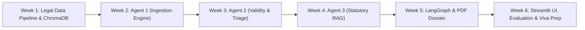

# 📅 LegalAdvisor AI: Day-to-Day Engineering Execution Roadmap

This document provides a structured, day-to-day project execution plan for **LegalAdvisor AI**. It translates the high-level roadmap into concrete daily deliverables spread over **6 Weeks (36 Active Working Days, Monday–Saturday)**, with Sundays reserved for review and buffer.

---

## 🎯 Master Timeline Overview

---

## 📅 Week 1: Legal Data Engineering & Vector Knowledge Base

> **Goal of the Week:** Have a local, persistent ChromaDB database populated with chunked Indian statutes that can be queried semantically from Python.

| Day | Primary Focus | Exact Tasks & Engineering Deliverables | Done? |
| :---: | :--- | :--- | :---: |
| **Day 1** | **Repository Setup & Environment** | • Initialize Python virtual environment (`python -m venv venv`). • Install core dependencies: `langchain`, `langgraph`, `chromadb`, `google-genai`, `python-dotenv`, `pypdf`. • Setup directory structure: `/data`, `/src/agents`, `/src/db`, `/src/utils`. | ⬜ |
| **Day 2** | **Statute Acquisition & Inspection** | • Download official PDFs for *Consumer Protection Act, 2019* and *Information Technology Act, 2000* from `indiacode.nic.in`. • Inspect PDF structures, section headings, definitions, and formatting anomalies. | ⬜ |
| **Day 3** | **Text Extraction & Cleaning Script** | • Build `src/db/extract_laws.py` to parse legal text from PDFs using `pypdf` or `pdfplumber`. • Sanitize footnotes, header/footer page numbers, and gazette watermarks. | ⬜ |
| **Day 4** | **Section-Aware Chunking Logic** | • Implement regular-expression-based chunker that splits text strictly by `Section X. [Title]`. • Attach rich metadata to each chunk: `{"act": "CPA_2019", "section": "86", "chapter": "VI", "title": "Product Liability"}`. | ⬜ |
| **Day 5** | **ChromaDB Ingestion & Persistence** | • Build `src/db/ingest_to_chroma.py`. • Generate embeddings using Google Gemini Embeddings (`text-embedding-004`). • Save to local persistent storage folder (`./chroma_data`). | ⬜ |
| **Day 6** | **RAG Retrieval Verification Test** | • Create `src/db/test_retrieval.py`. • Run 5 test queries (e.g., *"defective laptop refund refused"* or *"leaked personal customer data"*). • Verify that ChromaDB returns the exact target section and metadata. | ⬜ |
| **Day 7** | *Sunday Review & Sync* | *Team weekly sync: verify ChromaDB queries on all team machines.* | ☕ |

---

## 📅 Week 2: Agent 1 (Data Ingestion & Normalization Engine)

> **Goal of the Week:** A reliable multi-source ingestion module that outputs clean, standardized JSON objects from both Reddit and offline mock CSV files.

| Day | Primary Focus | Exact Tasks & Engineering Deliverables | Done? |
| :---: | :--- | :--- | :---: |
| **Day 8** | **Data Contract & JSON Schema Design** | • Define `PostSchema` using Pydantic in `src/utils/schemas.py`. • Mandatory fields: `post_id`, `source`, `timestamp`, `author_id`, `raw_text`, `platform`, `cleaned_text`. | ⬜ |
| **Day 9** | **Offline Mock Data Generator (CSV/JSON)** | • Create `data/mock_feed.csv` containing 30 representative posts (mix of happy reviews, spam, emotional anger, and concrete fraud/deficiency complaints). • Build `src/agents/batch_ingestion.py` to stream this CSV line-by-line. | ⬜ |
| **Day 10** | **Reddit API Integration (PRAW Setup)** | • Register a Reddit Developer Application and obtain `client_id` and `client_secret`. • Store credentials safely in `.env`. • Write `src/agents/reddit_harvester.py` to fetch top posts from target subreddits (e.g., `r/india`, `r/legaladviceindia`, or brand keywords). | ⬜ |
| **Day 11** | **Text Sanitization & Anonymization** | • Build cleaning functions: remove emojis, excessive punctuation, HTML tags, and URLs. • Implement basic PII masking (mask email addresses, phone numbers, and username tags) for privacy compliance. | ⬜ |
| **Day 12** | **Agent 1 Class & Standalone Execution** | • Wrap into a unified `HarvesterAgent` class with method `harvest(source="reddit" | "mock_csv")`. • Ensure consistent JSON normalization across all sources. | ⬜ |
| **Day 13** | **End-to-End Ingestion Testing** | • Write unit tests to verify that invalid inputs, empty posts, and network timeouts are handled gracefully without crashing. | ⬜ |
| **Day 14** | *Sunday Review & Sync* | *Test offline ingestion without internet connection to guarantee viva reliability.* | ☕ |

---

## 📅 Week 3: Agent 2 (Sentiment, Authenticity & Validity Triage)

> **Goal of the Week:** An intelligent classifier that separates emotional noise from actionable consumer grievances and defamation risks.

| Day | Primary Focus | Exact Tasks & Engineering Deliverables | Done? |
| :---: | :--- | :--- | :---: |
| **Day 15** | **Prompt Engineering for Sentiment & Rubric** | • Draft structured system prompt with explicit few-shot examples for the 4-tier rubric:   1. `Spam_Noise`   2. `Subjective_Hyperbole`   3. `Factual_Grievance`   4. `Defamation_Risk` | ⬜ |
| **Day 16** | **Structured Output with Gemini & Pydantic** | • Configure Gemini LLM with structured outputs (`response_schema=TriageOutputSchema`). • Ensure outputs include: `sentiment`, `validity_class`, `is_actionable` (bool), `urgency_score` (1-10), and `triage_reasoning`. | ⬜ |
| **Day 17** | **Agent 2 Node Implementation** | • Create `src/agents/triage_agent.py`. • Implement routing logic: if `is_actionable == False`, flag for audit logging; if `True`, prepare payload for Agent 3. | ⬜ |
| **Day 18** | **Validation Rubric Edge-Case Tuning** | • Test ambiguous posts: *"The app crashed, CEO is a thief"* vs *"The app crashed during UPI transaction and deducted ₹5,000 without booking"*. • Fine-tune prompt to ensure proper separation. | ⬜ |
| **Day 19** | **Benchmark Testing on Curated Dataset** | • Run Agent 2 through the 30 mock posts created in Week 2. • Measure classification accuracy, precision, and recall. Document results in spreadsheet. | ⬜ |
| **Day 20** | **Logging & Triage Audit Trail** | • Implement audit file logger (`logs/triage_history.jsonl`) to preserve intermediate reasoning steps for every processed post. | ⬜ |
| **Day 21** | *Sunday Review & Sync* | *Evaluate misclassified cases from Day 19 benchmark and refine system prompts.* | ☕ |

---

## 📅 Week 4: Agent 3 (Statutory Legal Consultation via RAG)

> **Goal of the Week:** A legal analyst agent that maps verified grievances to exact statutory sections and computes corporate exposure levels.

| Day | Primary Focus | Exact Tasks & Engineering Deliverables | Done? |
| :---: | :--- | :--- | :---: |
| **Day 22** | **Allegation Keyword & Query Extraction** | • Build a query generator that converts a raw grievance into high-signal legal search terms (e.g., *"misleading advertisement"*, *"product liability failure to warn"*). | ⬜ |
| **Day 23** | **Context Retrieval & Reranking** | • Connect Agent 3 to the Week 1 ChromaDB store. • Implement similarity search with score threshold to retrieve top-3 most relevant statutory sections with their metadata. | ⬜ |
| **Day 24** | **Statutory Mapping & Section Citation Prompt** | • Create `src/agents/legal_consultant_agent.py`. • Prompt Gemini to cross-reference the grievance against retrieved statutory clauses and extract the exact Act, Chapter, Section, and Subsection. | ⬜ |
| **Day 25** | **Exposure Scoring & Defense Synthesis** | • Implement exposure rating logic (`Low`, `Medium`, `High`, `Critical`) based on potential fines, consumer court remedies, or criminal liability. • Synthesize corporate next steps (e.g., immediate refund, formal clarification, evidence preservation). | ⬜ |
| **Day 26** | **Hallucination Guardrail Check** | • Implement citation verification: compare the cited Section in the LLM response against the metadata of the retrieved ChromaDB chunks. • If a section was not in the context, reject or flag as unverified. | ⬜ |
| **Day 27** | **Agent 3 Standalone Validation** | • Test Agent 3 on 5 verified consumer cases (e.g., e-commerce return dispute, medical device fault, unauthorized data sharing). • Verify that accurate CPA/IT Act sections are cited. | ⬜ |
| **Day 28** | *Sunday Review & Sync* | *Conduct team review of legal citation accuracy.* | ☕ |

---

## 📅 Week 5: Multi-Agent State Orchestration & PDF Dossier Engine

> **Goal of the Week:** Connect all 3 agents into a unified LangGraph workflow and generate professional, exportable PDF risk dossiers.

| Day | Primary Focus | Exact Tasks & Engineering Deliverables | Done? |
| :---: | :--- | :--- | :---: |
| **Day 29** | **LangGraph State Schema & Graph Setup** | • Define `LegalAdvisorState` in `src/graph/state.py`. • Build `StateGraph` in `src/graph/workflow.py`: define nodes for Harvester, Triage, and Legal Consultant. | ⬜ |
| **Day 30** | **Conditional Edges & State Reducers** | • Implement conditional router: after Triage node, route to `END` if non-actionable, or route to `LegalConsultant` if actionable. • Test full end-to-end graph execution in CLI. | ⬜ |
| **Day 31** | **ReportLab PDF Layout & Styling** | • Setup `src/utils/pdf_generator.py` using ReportLab. • Design clean corporate layout: title header, incident summary, severity badge (color-coded), citation table, and action items. | ⬜ |
| **Day 32** | **Statutory Disclaimer & Export Pipeline** | • Embed mandatory non-attorney legal disclaimer in PDF footer. • Implement file naming convention: `dossier_{post_id}_{timestamp}.pdf` saved to `/output/dossiers/`. | ⬜ |
| **Day 33** | **End-to-End Pipeline Integration** | • Connect LangGraph final node to the PDF generation utility. • Run a single command (`python main.py --source mock`) and verify that a complete PDF is generated from a raw post. | ⬜ |
| **Day 34** | **Error Handling & API Rate-Limit Protection** | • Implement try-catch blocks and exponential backoff retries around Gemini API and Reddit API calls. • Gracefully handle network disconnects. | ⬜ |
| **Day 35** | *Sunday Review & Sync* | *Generate 5 full sample PDF dossiers and review formatting with team members.* | ☕ |

---

## 📅 Week 6: UI Demo, Evaluation Benchmark & Viva Preparation

> **Goal of the Week:** A polished, clickable demo for presentations and concrete evaluation metrics to defend the project in front of examiners.

| Day | Primary Focus | Exact Tasks & Engineering Deliverables | Done? |
| :---: | :--- | :--- | :---: |
| **Day 36** | **Streamlit Dashboard Layout** | • Build `app.py` using Streamlit. • Add sidebar for inputs: select ingestion source (Reddit live or upload CSV), API key inputs, and run button. | ⬜ |
| **Day 37** | **Interactive Triage & Dossier Viewer UI** | • Display real-time execution logs showing the 3 agents working. • Display color-coded severity metrics and inline PDF download button for generated dossiers. | ⬜ |
| **Day 38** | **Final Benchmark Suite (50 Curated Posts)** | • Prepare `data/evaluation_benchmark_50.csv`: 15 positive/neutral, 15 hyperbole/spam, 10 consumer disputes, 10 defamation/IT risks. • Run full automated evaluation script. | ⬜ |
| **Day 39** | **Metrics & Evaluation Graph Generation** | • Calculate accuracy, precision, recall, and F1-score for Agent 2 triage. • Calculate citation accuracy percentage for Agent 3. • Export confusion matrix and charts for final college report. | ⬜ |
| **Day 40** | **College Project Report & PPT Finalization** | • Fill in placeholders in `SOFTWARE_REQUIREMENTS_SPECIFICATION.md`. • Insert architecture diagrams, benchmark tables, and screenshots into project presentation slide deck. | ⬜ |
| **Day 41** | **Dry-Run & Viva Simulation** | • Conduct end-to-end dry run: demonstrate live Reddit ingestion $\rightarrow$ triage $\rightarrow$ PDF generation in under 15 seconds. • Practice answers to common viva traps (hallucinations, multi-jurisdiction scope, offline fallback). | ⬜ |
| **Day 42** | *Project Submission & Celebration* | *Complete final deliverables, push to GitHub, submit report.* 🎉 | 🎓 |

---

## 📌 Daily Work Session Guidelines (For College Students)

* **Daily Commitment:** ~1.5 to 2 hours on weekdays; 3 to 4 hours on Saturday.
* **Standup Habit:** 5-minute daily check-in with your team partner(s) to verify:
  1. *What did we complete yesterday?*
  2. *What is our specific task for today from this plan?*
  3. *Is any API key or library blocking us?*
* **Commit Habit:** Always push code at the end of each day with clear commit messages (`feat: add section chunker for CPA 2019`, `test: verify Agent 2 triage accuracy`).
