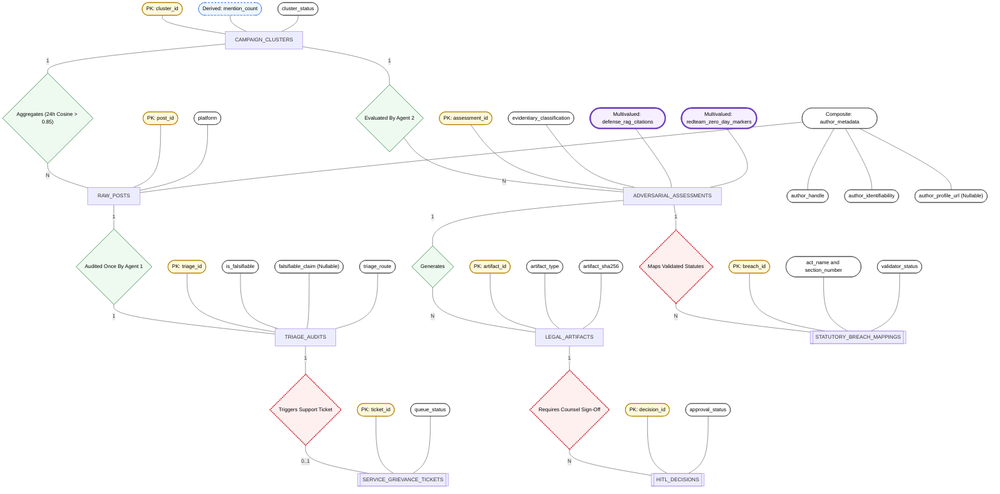

# LegalAdvisor AI: Entity-Relationship (ER) Diagram & `D3` Database Schema

**Aligned With:** [TECHNICAL_DESIGN_DOCUMENT.md](file:///d:/agentic_ai_project_1/college_project/TECHNICAL_DESIGN_DOCUMENT.md) (`Approved v1.0`, `ADR-001`–`ADR-008`) & [DATA_FLOW_DIAGRAMS.md](file:///d:/agentic_ai_project_1/college_project/DATA_FLOW_DIAGRAMS.md) (`D1`–`D4`)
**Database Engine:** SQLite (`D3: Operational Incident, Cluster & Audit DB` + LangGraph `SqliteSaver`)
**Normalization Target:** Third Normal Form (3NF) with strict relational integrity across ingestion, deduplication clustering, two-gate triage, adversarial verification, deterministic citation guarding, and HITL counsel review.

---

## 1. Multi-Store Architecture Boundary (`D1`–`D4`)

To prevent overloading SQLite with vector embeddings or large binary PDFs, persistent storage is partitioned across four stores, anchored by foreign-key / URI / hash pointers inside `D3`:

| Store ID         | Technology                      | Role                                                                   | Logical Reference Key from `D3`                      |
| :--------------- | :------------------------------ | :--------------------------------------------------------------------- | :----------------------------------------------------- |
| **`D1`** | ChromaDB (Local Disk)           | Statutory Knowledge Store (Indian Bare Statutes parent-child index)    | `STATUTORY_BREACH_MAPPINGS.statute_parent_id`        |
| **`D2`** | ChromaDB (Local Disk)           | Corporate Ground-Truth Store (SOC2, Privacy Policy, Security Docs)     | `ADVERSARIAL_ASSESSMENTS.defense_rag_citations_json` |
| **`D3`** | SQLite + `SqliteSaver`        | Operational Incident, Cluster, Audit, Breach & HITL Relational DB      | Primary source of truth (defined below)                |
| **`D4`** | Local Filesystem / Object Store | Immutable Legal Artifacts Repository (PDF/Markdown dossiers & notices) | `LEGAL_ARTIFACTS.storage_uri` + `artifact_sha256`  |

---

## 2. Conceptual & Physical ER Diagrams

To satisfy both **university DBMS theory evaluation (Chen Notation)** and **production backend engineering (Crow's Foot 3NF Schema)**, `D3` is documented in both views below.

### 2A. Conceptual ER Diagram (Chen Notation — Academic Report View)

Uses classic textbook symbols: **Single Rectangle** (Strong Entity), **Double Rectangle** (`[[...]]` Weak Entity), **Diamond** (Strong Relationship), **Bold/Dashed Diamond** (Weak Identifying Relationship), **Oval** (Simple/Key Attribute), **Branching Ovals** (Composite Attribute), **Thick-Border Oval** (Multivalued Attribute), and **Dashed Oval** (Derived Attribute). *(Note: When drawing in Draw.io/paper, underline `[PK]` attribute names inside ovals per Chen convention.)*



> [!NOTE]
> `EVALUATION_RUNS` (50-case `eval_dataset.json` telemetry executed by Admin `E4`) is a standalone audit entity unlinked to live discourse rows so test benchmarks never contaminate live incident queues; it is detailed in full in **2B** and **Section 4**.

---

### 2B. Physical ER Diagram (Crow's Foot Relational `erDiagram` — SQL Implementation View)

```mermaid
erDiagram
    CAMPAIGN_CLUSTERS ||--o{ RAW_POSTS : "aggregates (24h cosine > 0.85)"
    CAMPAIGN_CLUSTERS ||--o{ ADVERSARIAL_ASSESSMENTS : "evaluated by Agent 2"
    RAW_POSTS ||--|| TRIAGE_AUDITS : "audited once by Agent 1"
    RAW_POSTS ||--o| SERVICE_GRIEVANCE_TICKETS : "routes grievance to E3"
    TRIAGE_AUDITS ||--o| SERVICE_GRIEVANCE_TICKETS : "triggers callback ticket"
    ADVERSARIAL_ASSESSMENTS ||--o{ STATUTORY_BREACH_MAPPINGS : "maps validated D1 statutes"
    ADVERSARIAL_ASSESSMENTS ||--o{ LEGAL_ARTIFACTS : "generates notices & dossier"
    ADVERSARIAL_ASSESSMENTS ||--o{ HITL_DECISIONS : "reviewed by E2 counsel"
    LEGAL_ARTIFACTS ||--o{ HITL_DECISIONS : "approved or rejected in HITL"

    RAW_POSTS {
        string post_id PK "UUID primary key"
        string platform_post_id UK "Unique per platform + external ID"
        string platform "reddit | twitter | forum | mock"
        string author_handle "Sanitized / masked handle"
        string author_identifiability "IDENTIFIED | ANONYMOUS (ADR-005)"
        string author_profile_url "Nullable profile reference"
        string source_mode "PRAW_LIVE | MOCK_REPLAY (ADR-006)"
        string sanitized_text "Prompt-injection hardened text"
        string content_sha256 "SHA-256 of immutable post payload"
        string cluster_id FK "Nullable before Process 3.0"
        string ingested_at "ISO-8601 UTC timestamp"
    }

    CAMPAIGN_CLUSTERS {
        string cluster_id PK "UUID primary key"
        string canonical_claim_summary "Representative claim text"
        string representative_post_id FK "Anchor RAW_POSTS.post_id"
        int mention_count "Count of clustered duplicate claims"
        float cosine_threshold_used "Default 0.85 (ADR-006)"
        string window_start_at "24h deduplication window start"
        string window_end_at "24h deduplication window end"
        string cluster_status "OPEN | ESCALATED | FROZEN_ZERO_DAY | RESOLVED"
    }

    TRIAGE_AUDITS {
        string triage_id PK "UUID primary key"
        string post_id FK "Unique FK -> RAW_POSTS"
        bool stage_1a_regex_passed "Deterministic brand/length gate"
        bool is_falsifiable "Ollman Test outcome (Stage 1B)"
        string falsifiable_claim "Nullable extracted factual claim"
        string severity_category "DE_MINIMIS | SERVICE_GRIEVANCE | STATUTORY_CRIME | MALICIOUS_FRAUD"
        string triage_route "DISCARD | PR_SUPPORT_CALLBACK | LEGAL_INVESTIGATION"
        string filter_reason "Reason for discard or escalation"
        string llm_model "e.g. gemini-1.5-flash"
        int latency_ms "Execution latency in milliseconds"
        string evaluated_at "ISO-8601 UTC timestamp"
    }

    SERVICE_GRIEVANCE_TICKETS {
        string ticket_id PK "UUID primary key"
        string post_id FK "FK -> RAW_POSTS"
        string triage_id FK "Unique FK -> TRIAGE_AUDITS"
        string assigned_team "PR_SUPPORT (Entity E3)"
        string queue_status "QUEUED | ACKNOWLEDGED | RESOLVED"
        string created_at "ISO-8601 UTC timestamp"
    }

    ADVERSARIAL_ASSESSMENTS {
        string assessment_id PK "UUID primary key"
        string cluster_id FK "FK -> CAMPAIGN_CLUSTERS"
        string langgraph_thread_id "Links to LangGraph SqliteSaver checkpoint"
        string defense_hypothesis "Agent 2A Corporate RAG hypothesis"
        string defense_rag_citations_json "JSON array of D2 document IDs"
        float redteam_specificity_score "Agent 2B epistemic score (0.0 to 1.0)"
        string redteam_zero_day_markers_json "JSON array of technical IOCs"
        string evidentiary_classification "CLASS_A_BASELESS_SMEAR | CLASS_B_ZERO_DAY_AMBIGUITY | CLASS_C_SUBSTANTIATED_CRISIS"
        bool ciso_alert_required "True when Class B or Class C"
        string assessed_at "ISO-8601 UTC timestamp"
    }

    STATUTORY_BREACH_MAPPINGS {
        string breach_id PK "UUID primary key"
        string assessment_id FK "FK -> ADVERSARIAL_ASSESSMENTS"
        string statute_parent_id "D1 ChromaDB parent statute ID"
        string act_name "e.g. BNS 2023 | IT Rules 2021 | IT Act 2000"
        string section_number "e.g. Section 356 | Rule 3(1)(b)(v)"
        string relevance_summary "Closed-book mapping explanation"
        string validator_status "PASSED | REJECTED_UNRETRIEVED | REJECTED_REPEALED"
    }

    LEGAL_ARTIFACTS {
        string artifact_id PK "UUID primary key"
        string assessment_id FK "FK -> ADVERSARIAL_ASSESSMENTS"
        string artifact_type "INTERMEDIARY_TAKEDOWN | CEASE_AND_DESIST | ASHOK_KUMAR_PRESERVATION | EXECUTIVE_DOSSIER"
        string guardrail_status "PASSED | FAIL_CLOSED_WARNING"
        int retry_count "0 to 2 per ADR-004 reflection cap"
        string storage_uri "Path / URI in D4 repository"
        string artifact_sha256 "Tamper-evident forensic hash"
        bool disclaimer_verified "Non-attorney disclaimer embedded"
        string generated_at "ISO-8601 UTC timestamp"
    }

    HITL_DECISIONS {
        string decision_id PK "UUID primary key"
        string assessment_id FK "FK -> ADVERSARIAL_ASSESSMENTS"
        string artifact_id FK "Nullable FK -> LEGAL_ARTIFACTS"
        string counsel_reviewer_id "Entity E2 Corporate Counsel ID"
        string approval_status "PENDING | APPROVED | REJECTED | ESCALATED_CISO"
        string review_notes "Counsel sign-off or rejection rationale"
        string decided_at "ISO-8601 UTC timestamp"
    }

    EVALUATION_RUNS {
        string run_id PK "UUID primary key"
        string dataset_version "50-case eval_dataset.json version"
        int total_cases "Default 50 (ADR-008)"
        float false_legal_escalation_rate "Target 0.00"
        float zero_day_recall "Target >= 0.90"
        float citation_guardrail_pass_rate "Target 1.00"
        string executed_by_admin "Entity E4 Admin ID"
        string executed_at "ISO-8601 UTC timestamp"
    }
```



---

## 3. Architectural Design & Normalization Rationale

1. **Deduplication Before Heavy Compute (`CAMPAIGN_CLUSTERS`):**
   - `RAW_POSTS` references `CAMPAIGN_CLUSTERS` rather than tying `ADVERSARIAL_ASSESSMENTS` directly to every incoming social post. When a coordinated campaign spawns 150 near-identical accusations (`cosine_similarity > 0.85` within 24h), `mention_count` increments on the cluster while Agent 2 and Agent 3 execute only once per unique campaign claim (`ADR-006`).
2. **Strict Separation of Triage vs. Legal Investigation (`TRIAGE_AUDITS` vs. `ADVERSARIAL_ASSESSMENTS`):**
   - ~70–90% of `RAW_POSTS` terminate at `TRIAGE_AUDITS` (`DISCARD`) or `SERVICE_GRIEVANCE_TICKETS` (`PR_SUPPORT_CALLBACK` to `E3`), preserving auditability of why free speech/complaints were excluded without polluting legal tables.
3. **3NF Statutory Citations (`STATUTORY_BREACH_MAPPINGS`):**
   - Rather than burying citations in an unqueryable blob, individual breaches are normalized rows so queries can audit how often `Rule 3(1)(b)(v)` or `BNS 356` triggered, and record per-citation deterministic guardrail outcomes (`PASSED` vs `REJECTED_REPEALED`).
4. **Identifiability & Chain-of-Custody (`LEGAL_ARTIFACTS` & `HITL_DECISIONS`):**
   - Separates generated legal files (`D4` URIs + `artifact_sha256`) from human legal sign-off (`HITL_DECISIONS`), ensuring zero external legal transmission can occur without an `APPROVED` record authored by `E2`.
5. **Standalone Evaluation Metrics (`EVALUATION_RUNS`):**
   - Deliberately unlinked from live `RAW_POSTS` so offline 50-case `eval_dataset.json` regression runs (`ADR-008`, Process `7.0`) never mix synthetic test cases into live corporate incident queues.

---

## 4. Production SQLite DDL (`D3` Reference Schema)

```sql
PRAGMA foreign_keys = ON;

CREATE TABLE IF NOT EXISTS campaign_clusters (
    cluster_id TEXT PRIMARY KEY,
    canonical_claim_summary TEXT NOT NULL,
    representative_post_id TEXT,
    mention_count INTEGER NOT NULL DEFAULT 1 CHECK (mention_count >= 1),
    cosine_threshold_used REAL NOT NULL DEFAULT 0.85,
    window_start_at TEXT NOT NULL,
    window_end_at TEXT NOT NULL,
    cluster_status TEXT NOT NULL DEFAULT 'OPEN'
        CHECK (cluster_status IN ('OPEN', 'ESCALATED', 'FROZEN_ZERO_DAY', 'RESOLVED'))
);

CREATE TABLE IF NOT EXISTS raw_posts (
    post_id TEXT PRIMARY KEY,
    platform_post_id TEXT NOT NULL,
    platform TEXT NOT NULL CHECK (platform IN ('reddit', 'twitter', 'forum', 'mock')),
    author_handle TEXT NOT NULL,
    author_identifiability TEXT NOT NULL
        CHECK (author_identifiability IN ('IDENTIFIED', 'ANONYMOUS')),
    author_profile_url TEXT,
    source_mode TEXT NOT NULL CHECK (source_mode IN ('PRAW_LIVE', 'MOCK_REPLAY')),
    sanitized_text TEXT NOT NULL,
    content_sha256 TEXT NOT NULL,
    cluster_id TEXT REFERENCES campaign_clusters(cluster_id) ON DELETE SET NULL,
    ingested_at TEXT NOT NULL,
    UNIQUE (platform, platform_post_id)
);

CREATE TABLE IF NOT EXISTS triage_audits (
    triage_id TEXT PRIMARY KEY,
    post_id TEXT NOT NULL UNIQUE REFERENCES raw_posts(post_id) ON DELETE CASCADE,
    stage_1a_regex_passed INTEGER NOT NULL CHECK (stage_1a_regex_passed IN (0, 1)),
    is_falsifiable INTEGER NOT NULL CHECK (is_falsifiable IN (0, 1)),
    falsifiable_claim TEXT,
    severity_category TEXT NOT NULL
        CHECK (severity_category IN ('DE_MINIMIS', 'SERVICE_GRIEVANCE', 'STATUTORY_CRIME', 'MALICIOUS_FRAUD')),
    triage_route TEXT NOT NULL
        CHECK (triage_route IN ('DISCARD', 'PR_SUPPORT_CALLBACK', 'LEGAL_INVESTIGATION')),
    filter_reason TEXT NOT NULL,
    llm_model TEXT,
    latency_ms INTEGER NOT NULL CHECK (latency_ms >= 0),
    evaluated_at TEXT NOT NULL
);

CREATE TABLE IF NOT EXISTS service_grievance_tickets (
    ticket_id TEXT PRIMARY KEY,
    post_id TEXT NOT NULL REFERENCES raw_posts(post_id) ON DELETE CASCADE,
    triage_id TEXT NOT NULL UNIQUE REFERENCES triage_audits(triage_id) ON DELETE CASCADE,
    assigned_team TEXT NOT NULL DEFAULT 'PR_SUPPORT',
    queue_status TEXT NOT NULL DEFAULT 'QUEUED'
        CHECK (queue_status IN ('QUEUED', 'ACKNOWLEDGED', 'RESOLVED')),
    created_at TEXT NOT NULL
);

CREATE TABLE IF NOT EXISTS adversarial_assessments (
    assessment_id TEXT PRIMARY KEY,
    cluster_id TEXT NOT NULL REFERENCES campaign_clusters(cluster_id) ON DELETE CASCADE,
    langgraph_thread_id TEXT NOT NULL UNIQUE,
    defense_hypothesis TEXT NOT NULL,
    defense_rag_citations_json TEXT NOT NULL,
    redteam_specificity_score REAL NOT NULL
        CHECK (redteam_specificity_score >= 0.0 AND redteam_specificity_score <= 1.0),
    redteam_zero_day_markers_json TEXT NOT NULL,
    evidentiary_classification TEXT NOT NULL
        CHECK (evidentiary_classification IN (
            'CLASS_A_BASELESS_SMEAR',
            'CLASS_B_ZERO_DAY_AMBIGUITY',
            'CLASS_C_SUBSTANTIATED_CRISIS'
        )),
    ciso_alert_required INTEGER NOT NULL CHECK (ciso_alert_required IN (0, 1)),
    assessed_at TEXT NOT NULL
);

CREATE TABLE IF NOT EXISTS statutory_breach_mappings (
    breach_id TEXT PRIMARY KEY,
    assessment_id TEXT NOT NULL REFERENCES adversarial_assessments(assessment_id) ON DELETE CASCADE,
    statute_parent_id TEXT NOT NULL,
    act_name TEXT NOT NULL,
    section_number TEXT NOT NULL,
    relevance_summary TEXT NOT NULL,
    validator_status TEXT NOT NULL
        CHECK (validator_status IN ('PASSED', 'REJECTED_UNRETRIEVED', 'REJECTED_REPEALED'))
);

CREATE TABLE IF NOT EXISTS legal_artifacts (
    artifact_id TEXT PRIMARY KEY,
    assessment_id TEXT NOT NULL REFERENCES adversarial_assessments(assessment_id) ON DELETE CASCADE,
    artifact_type TEXT NOT NULL
        CHECK (artifact_type IN (
            'INTERMEDIARY_TAKEDOWN',
            'CEASE_AND_DESIST',
            'ASHOK_KUMAR_PRESERVATION',
            'EXECUTIVE_DOSSIER'
        )),
    guardrail_status TEXT NOT NULL
        CHECK (guardrail_status IN ('PASSED', 'FAIL_CLOSED_WARNING')),
    retry_count INTEGER NOT NULL DEFAULT 0 CHECK (retry_count >= 0 AND retry_count <= 2),
    storage_uri TEXT NOT NULL,
    artifact_sha256 TEXT NOT NULL,
    disclaimer_verified INTEGER NOT NULL CHECK (disclaimer_verified IN (0, 1)),
    generated_at TEXT NOT NULL
);

CREATE TABLE IF NOT EXISTS hitl_decisions (
    decision_id TEXT PRIMARY KEY,
    assessment_id TEXT NOT NULL REFERENCES adversarial_assessments(assessment_id) ON DELETE CASCADE,
    artifact_id TEXT REFERENCES legal_artifacts(artifact_id) ON DELETE SET NULL,
    counsel_reviewer_id TEXT NOT NULL,
    approval_status TEXT NOT NULL DEFAULT 'PENDING'
        CHECK (approval_status IN ('PENDING', 'APPROVED', 'REJECTED', 'ESCALATED_CISO')),
    review_notes TEXT,
    decided_at TEXT NOT NULL
);

CREATE TABLE IF NOT EXISTS evaluation_runs (
    run_id TEXT PRIMARY KEY,
    dataset_version TEXT NOT NULL,
    total_cases INTEGER NOT NULL CHECK (total_cases > 0),
    false_legal_escalation_rate REAL NOT NULL CHECK (false_legal_escalation_rate >= 0.0 AND false_legal_escalation_rate <= 1.0),
    zero_day_recall REAL NOT NULL CHECK (zero_day_recall >= 0.0 AND zero_day_recall <= 1.0),
    citation_guardrail_pass_rate REAL NOT NULL CHECK (citation_guardrail_pass_rate >= 0.0 AND citation_guardrail_pass_rate <= 1.0),
    executed_by_admin TEXT NOT NULL,
    executed_at TEXT NOT NULL
);

CREATE INDEX IF NOT EXISTS idx_raw_posts_cluster_time ON raw_posts(cluster_id, ingested_at);
CREATE INDEX IF NOT EXISTS idx_triage_route ON triage_audits(triage_route, evaluated_at);
CREATE INDEX IF NOT EXISTS idx_assessments_class ON adversarial_assessments(evidentiary_classification);
CREATE INDEX IF NOT EXISTS idx_hitl_status ON hitl_decisions(approval_status, decided_at);
```
