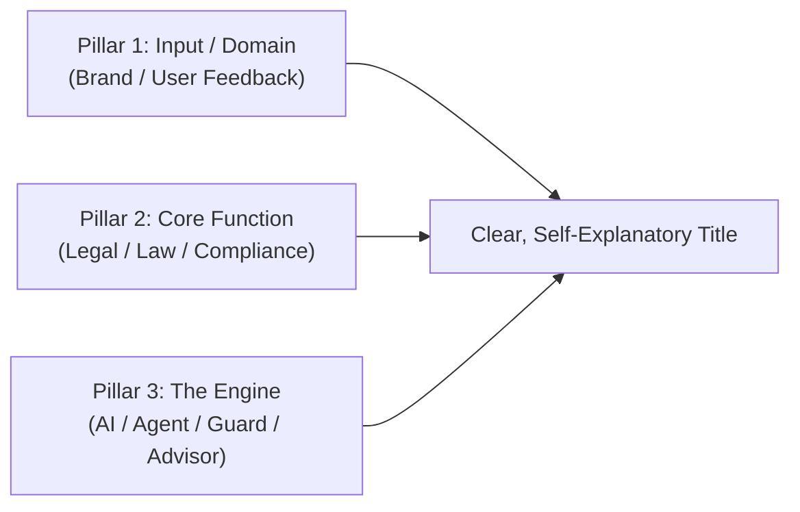

# Project Naming Proposals & Brand Identity Guide 🏷️

This document outlines proposed names, acronyms, subtitles, semantic rationales, and the mental model for naming our final-year college project on multi-agent legal consultation and risk intelligence.

---

## 📑 Table of Contents
1. [Executive Summary & Selection Criteria](#1-executive-summary--selection-criteria)
2. [The 3-Pillar Naming Mental Model (Clarity > Cleverness)](#2-the-3-pillar-naming-mental-model-clarity--cleverness)
3. [Category A: Simple, Self-Explanatory Titles with "AI" (Recommended ⭐)](#3-category-a-simple-self-explanatory-titles-with-ai-recommended-)
4. [Category B: Autonomous Advisor & Corporate Counsel Names](#4-category-b-autonomous-advisor--corporate-counsel-names)
5. [Category C: Academic & Research-Grade Latin/Lexical Titles](#5-category-c-academic--research-grade-latinlexical-titles)
6. [Category D: Enterprise SaaS & Modern Compound Names](#6-category-d-enterprise-saas--modern-compound-names)
7. [Category E: Meaningful Engineering Acronyms](#7-category-e-meaningful-engineering-acronyms)
8. [Comprehensive Comparison & Decision Matrix](#8-comprehensive-comparison--decision-matrix)
9. [Final Project Title Recommendation for College Report & Thesis](#9-final-project-title-recommendation-for-college-report--thesis)

---

## 1. Executive Summary & Selection Criteria

For a final-year engineering/business capstone, the project name needs to balance:
1. **Academic Clarity:** Viva examiners, university guides, and recruiters should instantly understand what the project does without decoding difficult vocabulary.
2. **Explicit "AI" Edge:** Including **"AI"** directly in the title highlights that the system is an intelligent, autonomous multi-agent pipeline rather than a static database.
3. **Technical Accuracy:** Reflects the 3-agent pipeline (Ingestion ➔ Sentiment & Validity Triage ➔ Statutory Legal Consultation).

---

## 2. The 3-Pillar Naming Mental Model (Clarity > Cleverness)

When evaluating a project title for external evaluators, avoid archaic or ambiguous terms (e.g., *Lex*, *Juris*, *Sentinel*) unless paired with plain English. Instead, follow the **3-Pillar Formula**:

$$\text{Project Title} = \text{[Domain / Input: Brand / Feedback]} + \text{[Problem Solved: Legal / Law / Risk]} + \text{[Technology: AI / Agent / Guard]}$$

---

## 3. Category A: Simple, Self-Explanatory Titles with "AI" (Recommended ⭐)
*Zero vocabulary barriers. Evaluators grasp the entire scope in 3 seconds.*

### 1. **LegalGuard AI**
- **Core Meaning:** An autonomous AI guardian providing legal protection against unlawful claims, defamation, and consumer disputes.
- **Subtitle for College Report:** *Autonomous Multi-Agent AI Framework for Public Feedback Triage and Statutory Legal Consultation*
- **Why it wins:** Simple, punchy, memorable, and immediately signals both the legal domain and artificial intelligence.

### 2. **BrandLegal AI**
- **Core Meaning:** Bridges public brand sentiment directly with legal compliance and corporate protection.
- **Subtitle for College Report:** *Multi-Agent AI Platform for Brand Risk Triage and Statutory Compliance Auditing*
- **Why it wins:** Highlights the business/enterprise angle of protecting corporate brand equity.

### 3. **LawShield AI**
- **Core Meaning:** An AI shield that protects corporations from legal vulnerabilities arising from online public feedback.
- **Subtitle for College Report:** *Autonomous Multi-Agent Legal Risk Assessment and Statutory Advisory System*

### 4. **FeedbackLegal AI**
- **Core Meaning:** Directly converts incoming customer feedback into structured legal consultation dossiers.
- **Subtitle for College Report:** *Agentic AI Framework for Consumer Feedback Analysis and Cross-Border Legal Advisory*

---

## 4. Category B: Autonomous Advisor & Corporate Counsel Names
*Emphasizes Agent 3's role as an autonomous legal consultant / corporate counsel.*

### 1. **LegalAdvisor AI**
- **Sub-Title:** *Autonomous Multi-Agent Legal Consultation for Corporate Brand Reputation*
- **Rationale:** Everyone understands what an advisor does; positions the software as an executive decision-support system.

### 2. **LegalCounsel AI**
- **Sub-Title:** *Autonomous In-House Legal Counsel for Public Discourse Triage and Risk Mitigation*
- **Rationale:** "Counsel" is the professional industry standard term used by corporate legal departments.

### 3. **RiskCounsel AI**
- **Sub-Title:** *Automated Corporate Risk Triage and Statutory Legal Advisory Engine*
- **Rationale:** Broadens the appeal to enterprise risk management and PR damage control.

---

## 5. Category C: Academic & Research-Grade Latin/Lexical Titles
*Best for formal research publications or if an evaluator appreciates classical legal terminology.*

### 1. **LexSentinel AI**
- **Etymology:** *Lex* (Law) + *Sentinel* (Guardian keeping watch) + *AI*.
- **Sub-Title:** *Autonomous Multi-Agent Legal Intelligence and Corporate Risk Assessment System*

### 2. **JurisIntellect AI**
- **Etymology:** *Juris* (Law) + *Intellect* (Cognitive reasoning).
- **Sub-Title:** *An Autonomous Multi-Agent Framework for Cross-Jurisdictional Legal Compliance*

### 3. **SentiLaw AI**
- **Etymology:** *Sentiment* (Emotion/Feedback) + *Law* (Statutory rules).
- **Sub-Title:** *Automated Brand Sentiment Analysis & Multi-Jurisdictional Statutory Risk Consultation*

---

## 6. Category D: Enterprise SaaS & Modern Compound Names

### 1. **VeriLex AI**
- **Etymology:** *Veritas* (Truth/Validity) + *Lex* (Law).
- **Tagline:** *Turning Public Discourse into Verified Legal Intelligence.*

### 2. **LexAudit AI**
- **Tagline:** *Autonomous Multi-Jurisdictional Brand & Legal Risk Auditing.*

### 3. **ClaimGuard AI**
- **Tagline:** *Automated Brand Grievance Triage and Statutory Section Identification.*

---

## 7. Category E: Meaningful Engineering Acronyms

### 1. **A.E.G.I.S. AI**
- **Full Form:** **A**utonomous **E**valuation of **G**rievances & **I**ntelligent **S**tatutory compliance
- **Significance:** In mythology, *Aegis* represents divine armor/shielding.

### 2. **J.U.R.I.S. AI**
- **Full Form:** **J**urisdictional **U**ser-feedback **R**eview & **I**ntelligence **S**ystem

---

## 8. Comprehensive Comparison & Decision Matrix

| Name | Clarity & Ease of Recall | Explicit "AI" Indicator | Academic Value | Corporate Appeal |
| :--- | :---: | :---: | :---: | :---: |
| **LegalGuard AI** | ⭐⭐⭐⭐⭐ (Instant) | ✅ Yes | ⭐⭐⭐⭐⭐ | ⭐⭐⭐⭐⭐ |
| **BrandLegal AI** | ⭐⭐⭐⭐⭐ (Instant) | ✅ Yes | ⭐⭐⭐⭐ | ⭐⭐⭐⭐⭐ |
| **LegalAdvisor AI** | ⭐⭐⭐⭐⭐ (Instant) | ✅ Yes | ⭐⭐⭐⭐⭐ | ⭐⭐⭐⭐ |
| **VeriLex AI** | ⭐⭐⭐ (Needs context) | ✅ Yes | ⭐⭐⭐⭐ | ⭐⭐⭐⭐⭐ |
| **LexSentinel AI** | ⭐⭐⭐ (High vocabulary) | ✅ Yes | ⭐⭐⭐⭐⭐ | ⭐⭐⭐⭐ |
| **A.E.G.I.S. AI** | ⭐⭐⭐ (Acronym) | ✅ Yes | ⭐⭐⭐⭐⭐ | ⭐⭐⭐ |

---

## 9. Final Project Title Recommendation for College Report & Thesis

### 🥇 Top Choice: **`LegalGuard AI`**
* **Short Project Title:** **LegalGuard AI**
* **Full Academic Title for Final Report, Presentation & Thesis:**
  > **LegalGuard AI: An Autonomous Multi-Agent Framework for Public Feedback Triage and Statutory Legal Consultation**

* **Alternative Top Pick (Brand-Centric):**
  > **BrandLegal AI: Autonomous Multi-Agent Intelligence for Brand Sentiment Triage and Multi-Jurisdictional Legal Risk Assessment**

---
*Created: October 31, 2026 | College Project Documentation Space*
