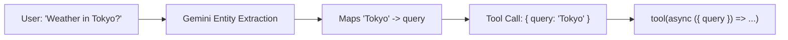
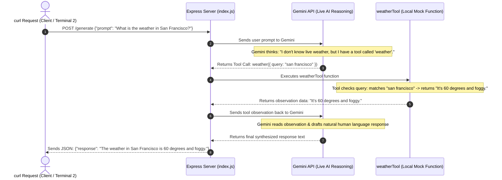
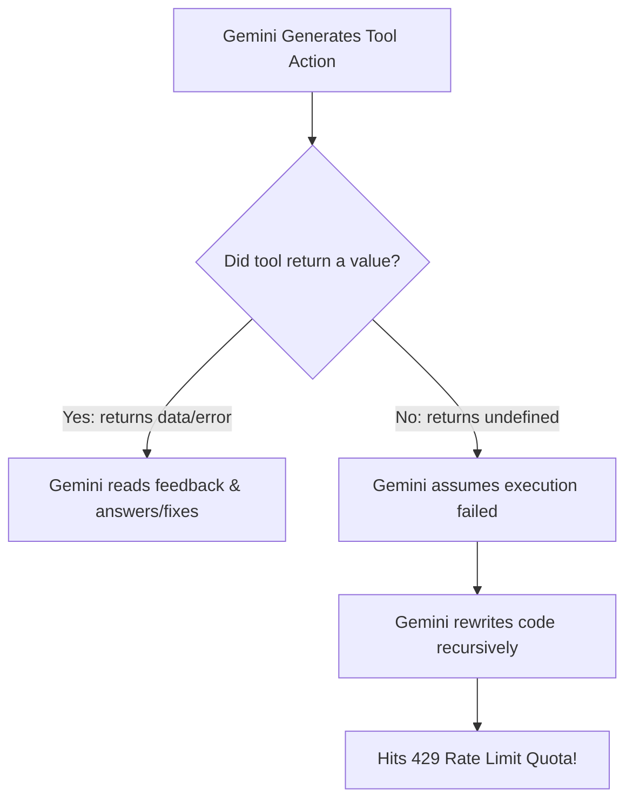

# Agentic AI Learning & Project Notes 🚀

This document tracks all the concepts, questions, architecture patterns, debugging lessons, and code implementations learned throughout building this project.

---

## 📑 Table of Contents
1. [Project Overview & Architecture](#1-project-overview--architecture)
2. [Environment Setup & Best Practices](#2-environment-setup--best-practices)
3. [Core Concepts](#3-core-concepts)
   - [What is a ReAct Agent?](#what-is-a-react-agent)
   - [LLM Model Selection & API Endpoints](#llm-model-selection--api-endpoints)
   - [Model Configuration (`apiKey` fallback & `temperature: 0`)](#model-configuration-apikey-fallback--temperature-0)
   - [Tool Definition & Deep Dive into Zod (`z`, `.describe()`, Schemas)](#tool-definition--deep-dive-into-zod-z-describe-schemas)
   - [How the LLM Extracts Arguments from User Input](#how-the-llm-extracts-arguments-from-user-input)
   - [How Agent Responses Work: Mock Data vs Live Gemini API](#how-agent-responses-work-mock-data-vs-live-gemini-api)
   - [The ReAct Self-Correction Loop & Missing Return Values Trap](#the-react-self-correction-loop--missing-return-values-trap)
   - [Dynamic Code Execution in AI: Understanding `eval()`](#dynamic-code-execution-in-ai-understanding-eval)
   - [State Management & Checkpointers (`MemorySaver`)](#state-management--checkpointers-memorysaver)
   - [Understanding `thread_id` & Session Tracking](#understanding-thread_id--session-tracking)
   - [API Testing & Terminal Tools (`curl` in PowerShell)](#api-testing--terminal-tools-curl-in-powershell)
   - [Multi-Terminal Workflows & Testing Endpoints](#multi-terminal-workflows--testing-endpoints)
4. [Step-by-Step Chronological Code Evolution](#4-step-by-step-chronological-code-evolution)
   - [Phase 1: Basic Gemini Agent Setup](#phase-1-basic-gemini-agent-setup)
   - [Phase 2: Adding Custom Tools (Weather Tool)](#phase-2-adding-custom-tools-weather-tool)
   - [Phase 3: Multi-turn Memory with Checkpointers (`MemorySaver`)](#phase-3-multi-turn-memory-with-checkpointers-memorysaver)
   - [Phase 4: Express Server Integration (`/generate` REST API)](#phase-4-express-server-integration-generate-rest-api)
   - [Phase 5: Multi-Tool Agent & JS Code Execution Agent (`jsExecutor`)](#phase-5-multi-tool-agent--js-code-execution-agent-jsexecutor)
5. [Common Errors & Debugging Log](#5-common-errors--debugging-log)

---

## 1. Project Overview & Architecture

* **Frameworks & Libraries:**
  * [`express`](https://expressjs.com/): Fast web server framework to expose the agent via HTTP POST/GET endpoints.
  * [`cors`](https://github.com/expressjs/cors): Middleware to enable Cross-Origin Resource Sharing for frontend access.
  * [`@langchain/langgraph`](https://github.com/langchain-ai/langgraphjs): Orchestrates graph workflows, agents, loops, and persistence.
  * [`@langchain/google-genai`](https://github.com/langchain-ai/langchainjs): Connects to Google's Gemini LLMs.
  * [`@langchain/core`](https://github.com/langchain-ai/langchainjs): Core primitives (tools, messages, runnables).
  * [`zod`](https://zod.dev/): Schema definition and runtime type-safety for tool parameters.
  * [`dotenv`](https://github.com/motdotla/dotenv): Environment variable loader.

* **Directory Structure:**
  ```text
  d:\agentic_ai_project_1\
  ├── client/               # Frontend (UI)
  ├── server/               # Backend services
  │   └── agent/            # Agentic AI implementation
  │       ├── .env          # API keys (ignored by git)
  │       ├── .gitignore    # Ignore rules
  │       ├── package.json  # Node dependencies
  │       ├── index.js      # Express server entry point (/generate endpoint)
  │       ├── agent.js      # Agent logic & exported agent instance
  │       ├── README.md     # (This file) Agentic AI Learning & Reference Log
  │       ├── NODE_JS_FUNDAMENTALS.md # Core Node & JS Handbook
  │       └── PROJECT_REQUIREMENTS.md # Master Requirements & Rules Register
  └── .gitignore
  ```

---

## 2. Environment Setup & Best Practices

### Installing Dependencies
```powershell
# Inside server/agent:
npm install express cors @langchain/langgraph @langchain/core @langchain/google-genai zod dotenv
```

### Environment Variables (`.env`)
Store sensitive keys securely in `server/agent/.env`:
```env
GOOGLE_API_KEY=your_gemini_api_key_here
# or GEMINI_API_KEY=your_gemini_api_key_here
PORT=3001
```

### Why `import 'dotenv/config';` is placed at the top
* In ES Modules (`"type": "module"`), `import` statements are hoisted and run before the rest of the script.
* Putting `import 'dotenv/config';` at the top guarantees `process.env` has your API keys loaded **before** `new ChatGoogleGenerativeAI(...)` tries to access them.

---

## 3. Core Concepts

### What is a ReAct Agent?
**ReAct** stands for **Reason + Act**:
1. **Thought:** The model analyzes the input.
2. **Action:** The model determines if it needs an external tool and issues a tool call.
3. **Observation:** The environment executes the tool and returns output to the model.
4. **Final Answer:** The model synthesizes the observation into a response.

### LLM Model Selection & API Endpoints
* Older models like `gemini-1.5-flash` or `gemini-2.0-flash` were deprecated on the API endpoint.
* Current standard Gemini models:
  * `gemini-2.5-flash` / `gemini-2.5-flash-lite`: Fast, lightweight, cost-effective.
  * `gemini-3.6-flash` / `gemini-3.8-flash`: High-performance flash models for complex agent reasoning.
  * `gemini-2.5-pro`: Deep multi-step reasoning.

### Model Configuration (`apiKey` fallback & `temperature: 0`)
```javascript
const model = new ChatGoogleGenerativeAI({
  model: 'gemini-3.6-flash',
  apiKey: process.env.GEMINI_API_KEY || process.env.GOOGLE_API_KEY,
  temperature: 0,
});
```
* **`apiKey: process.env.GEMINI_API_KEY || process.env.GOOGLE_API_KEY`:**
  * Fallback mechanism ensuring compatibility whether the `.env` variable is named `GEMINI_API_KEY` or `GOOGLE_API_KEY`.
* **`temperature: 0`:**
  * Sets the model to **deterministic/focused** mode. Essential for agents to strictly adhere to Zod tool schemas and prevent hallucinated arguments.

### Tool Definition & Deep Dive into Zod (`z`, `.describe()`, Schemas)
```javascript
import { tool } from '@langchain/core/tools';
import { z } from 'zod';

const weatherTool = tool(
  async ({ query }) => {
    if (query.toLowerCase().includes('san francisco')) {
      return "It's 60 degrees and foggy.";
    }
    return "It's 90 degrees and sunny.";
  },
  {
    name: 'weather',
    description: 'Get Weather in a specific city',
    schema: z.object({
      query: z.string().describe('The query to use in your search.'),
    }),
  }
);
```
* **What is `z`?** The instance of the **Zod** schema validation library.
* **Who gets the `.describe()` string?** The **LLM (Gemini)** receives this description inside the JSON Schema definition. It never prints to your terminal.
* **Who is "you" in "The query to use in your search"?** "You" refers directly to **Gemini**. It tells Gemini: *"When you search, put your search keyword in this field."*
* **What `schema` does under the hood:** LangGraph transforms the Zod schema into a JSON Schema payload:
  ```json
  {
    "name": "weather",
    "description": "Get Weather in a specific city",
    "parameters": {
      "type": "object",
      "properties": {
        "query": {
          "type": "string",
          "description": "The query to use in your search."
        }
      },
      "required": ["query"]
    }
  }
  ```

### How the LLM Extracts Arguments from User Input
When a user asks *"What is the weather in Tokyo?"*:
1. Gemini recognizes the user's intent is weather information.
2. It performs **Named Entity Recognition (NER)** and identifies `"Tokyo"` as the target entity.
3. It maps `"Tokyo"` into the `query` property instructed by `.describe()`.
4. It issues the tool call: `{ name: "weather", args: { query: "Tokyo" } }`.
5. LangGraph receives this JSON, unpacks `{ query }`, and runs your JavaScript tool function.



### How Agent Responses Work: Mock Data vs Live Gemini API
When you request weather or custom data, output generation is a collaboration between Gemini and your local tool:



### The ReAct Self-Correction Loop & Missing Return Values Trap
* **The "Black Hole" Tool Trap:** If your tool logs to console (`console.log`) but does **not `return` a string/value**, JavaScript returns `undefined`.
* **What the LLM experiences:** Gemini sends a tool call and receives empty silence (`undefined`). It assumes the code failed or had a bug, so it rewrites the code using another library (e.g. `fetch` ➔ `https` ➔ `execSync` with `curl`).
* **Rate Limit Exhaustion (`429 Too Many Requests`):** Because Gemini keeps retrying rapidly to get a valid response, it exhausts the 5 Requests Per Minute (RPM) free tier quota.
* **The Golden Rule:** Always **`return`** the result (or the error in a `catch` block) so the LLM gets immediate feedback!



### Dynamic Code Execution in AI: Understanding `eval()`
* **What is `eval()`?** A built-in JavaScript function that evaluates a string of code dynamically at runtime.
* **Use in Agents:** Allows an LLM to generate custom computational code or API calls that Node.js executes dynamically.
* **Security Caveat:** In production environments, untrusted LLM code should run in sandboxed environments (Docker, WebAssembly, or Node's `vm` module) rather than raw `eval()`.

### State Management & Checkpointers (`MemorySaver`)
* Agents are stateless by default.
* `MemorySaver` provides an in-memory checkpointer that snapshots the conversation state after every graph step.

### Understanding `thread_id` & Session Tracking
* **What is `thread_id`?** The unique string identifier of a conversation thread.
* **Continuous Chat:** Uses the **same `thread_id`** across all turns so the agent remembers past context.
* **Data Type Requirement:** `thread_id` **MUST be a string** (e.g., `'42'`, `'session-123'`, UUID). Numbers cause a runtime exception in `MemorySaver`.

### API Testing & Terminal Tools (`curl` in PowerShell)
* **`curl.exe` on Windows:** In PowerShell 5.1, `curl` is aliased to `Invoke-WebRequest`. Use `curl.exe` to invoke the native binary directly.
* **Escaping the `>>` Prompt Trap:** Unclosed quotes or apostrophes (e.g. `What's`) cause PowerShell to wait for input (`>>`). Press `Ctrl + C` to escape.

### Multi-Terminal Workflows & Testing Endpoints
* **Terminal 1 (Server):** Runs `node index.js` (listening on port `3001`).
* **Terminal 2 (Client / Tester):** Sends requests with `curl.exe` or `Invoke-RestMethod` to trigger agent workflows in real time.

---

## 4. Step-by-Step Chronological Code Evolution

### Phase 1: Basic Gemini Agent Setup
Created initial `server/agent/agent.js` connecting `ChatGoogleGenerativeAI` with `createReactAgent`.

### Phase 2: Adding Custom Tools (Weather Tool)
Added `weatherTool` with strict Zod schema validation:
```javascript
const weatherTool = tool(
  async ({ query }) => {
    if (query.toLowerCase().includes('san francisco')) {
      return "It's 60 degrees and foggy.";
    }
    return "It's 90 degrees and sunny.";
  },
  {
    name: 'weather',
    description: 'Get Weather in a specific city',
    schema: z.object({
      query: z.string().describe('The query to use in your search.'),
    }),
  }
);
```

### Phase 3: Multi-turn Memory with Checkpointers (`MemorySaver`)
Attached `MemorySaver` and configured `thread_id: '42'` to retain state across conversational turns.

### Phase 4: Express Server Integration (`/generate` REST API)
Created `server/agent/index.js` to expose the agent via HTTP POST endpoint with CORS and JSON body parsing.

### Phase 5: Multi-Tool Agent & JS Code Execution Agent (`jsExecutor`)
Expanded `agent.js` to equip the agent with a dynamic JavaScript execution tool:

```javascript
// server/agent/agent.js
import 'dotenv/config';
import { createReactAgent } from '@langchain/langgraph/prebuilt';
import { ChatGoogleGenerativeAI } from '@langchain/google-genai';
import { tool } from '@langchain/core/tools';
import { z } from 'zod';
import { MemorySaver } from '@langchain/langgraph';

// Tool 1: Weather Lookup
const weatherTool = tool(
  async ({ query }) => {
    if (query.toLowerCase().includes('san francisco')) {
      return "It's 60 degrees and foggy.";
    }
    return "It's 90 degrees and sunny.";
  },
  {
    name: 'weather',
    description: 'Get Weather in a specific city',
    schema: z.object({
      query: z.string().describe('The query to use in your search.'),
    }),
  }
);

// Tool 2: Dynamic JavaScript Executor
const jsExecutor = tool(
  async ({ code }) => {
    console.log('I should run the following code:');
    console.log(code);
    // Note: Returning stdout/result gives feedback to the LLM
  },
  {
    name: 'run_javascript_code_tool',
    description: `
      Run general purpose javascript code. 
      This can be used to access Internet or do any computation that you need. 
      The output will be composed of the stdout and stderr. 
      The code should be written in a way that it can be executed with javascript eval in node environment.
    `,
    schema: z.object({
      code: z.string().describe('The code to run.'),
    }),
  }
);

const checkpointSaver = new MemorySaver();

const model = new ChatGoogleGenerativeAI({
  model: 'gemini-3.6-flash',
  apiKey: process.env.GEMINI_API_KEY || process.env.GOOGLE_API_KEY,
  temperature: 0,
});

export const agent = createReactAgent({
  llm: model,
  tools: [weatherTool, jsExecutor],
  checkpointSaver,
});
```

```javascript
// server/agent/index.js
import express from 'express';
import cors from 'cors';
import { agent } from './agent.js';

const app = express();
const port = 3001;

app.use(express.json());
app.use(cors({ origin: '*' }));

app.get('/', (req, res) => {
  res.send('Hello World!');
});

app.post('/generate', async (req, res) => {
  const { prompt, thread_id } = req.body;
  const result = await agent.invoke(
    {
      messages: [
        {
          role: 'user',
          content: prompt,
        },
      ],
    },
    { configurable: { thread_id: String(thread_id) } }
  );
  res.json({ response: result.messages.at(-1)?.content });
});

app.listen(port, () => {
  console.log(`Server is running on http://localhost:${port}`);
});
```

---

## 5. Common Errors & Debugging Log

| Error / Issue | Root Cause | Solution |
| :--- | :--- | :--- |
| `RateLimitQuotaExhaustedError: [429 Too Many Requests]` | Agent looped repeatedly generating code because `jsExecutor` returned `undefined` without feedback. | Ensure tool returns execution output (`return String(result)`) or error message in `catch`. |
| `Error: Cannot find module '.../index.js'` (`MODULE_NOT_FOUND`) | Ran `node index.js` from project root instead of directory containing `index.js`. | `cd server/agent` first, or run `node server/agent/index.js`. |
| `>>` prompt loop in PowerShell | An apostrophe (e.g. `What's`) or unescaped quote caused PowerShell to wait for closing quotes. | Press `Ctrl + C` to escape, and format JSON string properly without unescaped apostrophes. |
| `createReactAgent` strikethrough in IDE | Marked `@deprecated` in newer typings in favor of explicit graph APIs. | Harmless editor warning. The function runs without runtime issues. |
| `[404 Not Found] models/gemini-1.5-flash is not found` | The model identifier was deprecated or not supported on that API version. | Update `model` parameter to available versions like `gemini-3.6-flash` or `gemini-3.8-flash`. |
| `SyntaxError: Unexpected token '{'` on `agent.invoke` | `configurable` config was pasted inside the message payload object instead of passing it as the 2nd argument. | Pass input as argument 1 and config as argument 2: `agent.invoke({ messages: [...] }, { configurable: { thread_id: '42' } })`. |
| `Error: Invalid configurable value for key "thread_id": expected a string identifier (got number)` | Passed a numeric value (e.g., `42`) to `thread_id`. `MemorySaver` requires string keys. | Wrap the thread identifier in quotes (e.g. `'42'`) or cast with `String(thread_id)`. |
| `Error: Please set an API key for Google Generative AI` | Environment variable was named `GEMINI_API_KEY` but SDK searched for `GOOGLE_API_KEY`. | Use `apiKey: process.env.GEMINI_API_KEY \|\| process.env.GOOGLE_API_KEY`. |
| PowerShell `Invoke-WebRequest` Script Execution Risk warning when running `curl` | `curl` is aliased to `Invoke-WebRequest` in PowerShell 5.1. | Use `curl.exe http://localhost:3001` or add `-UseBasicParsing`. |
